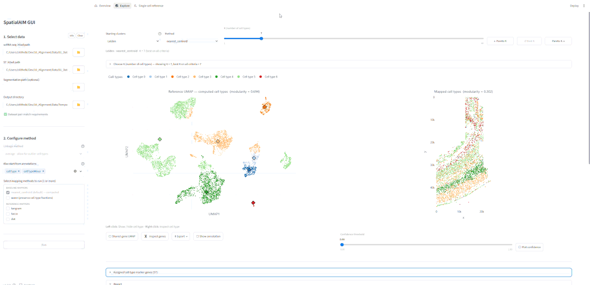

# SpatialAIM — Annotation-Independent Mapping

**Quick install**

```bash
# Install from PyPi
pip install spatial-aim
# Run GUI
spatialaim gui
```

---

**SpatialAIM** maps an **unannotated** scRNA-seq reference (scRNA) onto single-cell-resolution spatial transcriptomics (ST) in a **GUI** or **CLI**. For a scRNA/ST pair it:

1. **Over-clusters** the scRNA reference once with Leiden into `L` start clusters.
2. Builds **one agglomeration tree** over those start clusters.
3. **Sweeps `K`**: for every `K` in `(1,L)` it cuts the tree into `K` cell states and assigns **exactly one** to each spot, reconstructing spot expression from the state profiles.
4. **Finds best `K`**: computes metrics (reconstruction quality, spatial coherence and transcriptional coherence) and helps the user find the most sensible cell state granularity via an interactive GUI.

The spot→state step is **modular**. In principle, any scRNA to ST alignment tool can be used here.
We implement two baseline mappers (`nearest_centroid`, `wann`) and three reference mappers (`tangram`,  `tacco`, `dot`).
You are invited to add and try out your mapper of choice!

If you also want to start Step 1 from your own annotations,
`--annotation` runs the sweep a second time (once per annotation) with an existing annotation's `L` cell types as the start clusters.


## Outline

- [Why SpatialAIM?](#why-spatialaim)
- [Input data format](#input-data-format)
- [For users](#for-users)
- [For developers](#for-developers)

## Why SpatialAIM?

Conventional mapping methods blindly map a **pre-annotated** scRNA reference onto spots, even if there is not enough signal in the spatial data to reliably distinguish between them.
The hierarchical cell type clustering is based on both the scRNA and the ST data at hand. The user can find a cell type granularity that can be mapped reliably.



## Input data format

To run SpatialAIM, you need a pair of a scRNA dataset and a ST dataset, both as raw counts in `.h5ad` format.

- **scRNA `<Name>.h5ad`**: `X` = raw counts (cells × genes);  `var_names` = **uppercase** gene symbols.
- **ST `<Name>.h5ad`**: `X` = raw counts (spots × genes);  `var_names` = **uppercase** gene symbols; `obsm["spatial"]` = (x, y)-coordinates of the spots: (n_spots × 2).

### Single pair

Just have the two `.h5ad` files available and you are good to go.

### Batch processing

SpatialAIM also supports batch processing of multiple pairs.
Organise the data relationally the following way so one scRNA reference can be reused  across many ST slices:

```
DATA/
├── scRNA/
│   ├── index.csv          # one row per scRNA dataset
│   └── <scName>.h5ad
├── ST/
│   ├── index.csv          # one row per ST dataset
│   ├── <stName>.h5ad
│   └── Segmentation/      # optional cell segmentation masks (index.csv column `Segmentation`)
└── pairs.csv              # links scRNA ↔ ST: PairID, scName, stName, …
```

See [`sample_dataset/`](sample_dataset) for a minimal example, and validate your own layout with [`spatialaim validate`](#validate-a-dataset-pair-spatialaim-validate).

## For users

### Installation

SpatialAIM is installable from PyPI:

```bash
pip install spatial-aim
```

This installs one command, `spatialaim`, with subcommands (`spatialaim --help`).
You can now already run `spatialaim` with the baseline mappers.

If you want to be able to select one of the reference aligners within SpatialAIM, you need `conda` installed on your machine.
Please install the corresponding conda environments on your computer.

| Method  | Environment   | Command                                                                                                                                                                              |
| ------- | ------------- | ------------------------------------------------------------------------------------------------------------------------------------------------------------------------------------ |
| Tangram | `tangram_env` | `conda env create -f https://raw.githubusercontent.com/domipysch/SpatialAIM-Repository/main/src/spatialaim/reference_aligners/environment_tangram.yml`                                                        |
| TACCO   | `tacco_env`   | `conda env create -f https://raw.githubusercontent.com/domipysch/SpatialAIM-Repository/main/src/spatialaim/reference_aligners/environment_tacco.yml`                                                          |
| DOT     | `dot_env`     | `conda env create -f https://raw.githubusercontent.com/domipysch/SpatialAIM-Repository/main/src/spatialaim/reference_aligners/environment_dot.yml` then `Rscript -e "remotes::install_github('saezlab/DOT')"` |

> For SpatialAIM to use the environments, please make sure SpatialAIM can find your conda executable.
> Either set the environment variable `CONDA_EXE` or add your path to your conda installation to `PATH`.
> Make sure `exe = os.environ.get("CONDA_EXE") or shutil.which("conda")` returns the path to your conda.

### Validate a dataset pair (`spatialaim validate`)

Check whether your data meets the main requirements.

```bash
spatialaim validate --scdata path/to/sc.h5ad --stdata path/to/st.h5ad [--segmentation path/to/mask.tif]
```

or for every pair of a `pairs.csv` laid out as in [Batch Processing](#batch-processing):

```bash
spatialaim validate --pairs_csv path/to/DATA/pairs.csv
```

Validations per dataset:

- scRNA reference data alone
  - raw count matrices (no NaN values, np negative values, integer-looking, not library-size normalized or log1p'd)
  - unique uppercase gene names
- ST data alone
  - raw count matrices (no NaN values, np negative values, integer-looking, not library-size normalized or log1p'd)
  - unique uppercase gene names
  - `obsm["spatial"]` of shape `(n_spots, 2)`.
- Optional cell segmentation mask of an ST slice
  - a 2D `.tif`/`.tiff` of dtype `uint32`: `0` = background, cells labelled `1..max` without gaps (labels without a cell in the h5ad are fine)
  - the ST h5ad carries the integer `obs["segmentation_id"]` (each cell's mask label, `0` = no segmentation): non-negative, non-zero ids unique and present in the mask
  - `uns["segmentation_pixel_size_um"]` (µm per pixel) is optional - a warning if missing
- Per pair
  - the size of the shared-gene intersection
  - whether any ST spot is left all-zero by it.
- If an `index.csv` sits next to the `.h5ad` files, its recorded counts and cell-type keys are cross-checked as well.

### Run via GUI (`spatialaim gui`)

Interactive [Streamlit](https://streamlit.io) app to run SpatialAIM from the browser and interactively browse the results for one scRNA/ST pair without any .

```bash
spatialaim gui [--server_port 8501]
```

Open the printed URL (default http://localhost:8501), set the inputs, pick one or multiple mapper(s), and click **Run**.
As soon as both `.h5ad` paths are set, the GUI runs the same checks as [`spatialaim validate`](#validate-a-dataset-pair-spatialaim-validate) on that pair: a clean pair is confirmed with a tick in the sidebar, any error or warning is shown in a dialog you can close to continue anyway.
The GUI always runs from the Leiden over-clustering; pick annotations under *Also start from annotations* to additionally start from them (the same as `--annotation`).
It writes the same layout as the CLI, `<output_dir>/<start>/<mapper>/`. The results are pages in a top navigation: **Overview** (a table of every starting point × mapper at its best overall K, sorted by the overall score; a selected row opens it in Explore), **Explore** (pick starting clusters, method and K in one control bar; switching start or method lands on that combination's best K), **Compare** (several methods of one starting point side by side, once two have finished) and **Single-cell reference**.
Once an output folder holds results, its linkage is fixed. Mappers and annotations can still be added: the next *Run* computes every missing starting point × mapper combination. Output folders written by earlier versions (`<output_dir>/<mapper>/`) can still be opened and viewed.
An optional **Segmentation path** (the ST slice's cell segmentation mask, see the sidebar's *Info*) is validated with the pair and passed to the runs; their Explore views then get a "Shape features" card (shape consistency and the cells' area / eccentricity / solidity per cell type), and the cell-type modal a "Shape features" view. Without it the GUI is unchanged.

`spatialaim gui --demo_data <dir>` serves the read-only online demo instead: a pick of precomputed public pairs, no runs, no exports. Building and deploying it as a Docker container: [deploy/demo/README.md](deploy/demo/README.md).

### Run via CLI (`spatialaim run`)

Run SpatialAIM via CLI on a single pair or in batch mode.
The spot→state mapper is chosen with argument `--mapping`:

- **`nearest_centroid`** (default): Per spot, select the cell state by highest cosine similarity between the state's centroid and the spot's expression. One-hot assignment by default.
- **`wann`**: Weighted Adaptive Nearest Neighbor (Di Salvo et al., TMLR 2025): each reference cell gets a label-reliability score; each spot inherits the neighbourhood size of its nearest reference cell and votes over its nearest neighbours (labelled single reference cells by cosine distance) weighted by reliability.
- **`tangram` / `tacco` / `dot`**: delegate the spot→state step to given external aligner (one alignment per `K`, run in its own conda env; slower). Requires the corresponding reference env (see [Installation](#installation)).

The linkage of the agglomeration tree over the start clusters is chosen with `--linkage_method`:

- **`average`** (default): UPGMA — average pairwise distance; no size term, tends to peel small tight groups off a growing dominant state.
- **`ward`**: Ward's criterion (R's `ward.D`); carries a size term and tends to produce balanced states.

The **start clusters** the tree is built over come from the Leiden over-clustering.
Pass `--annotation <obs_column> [<obs_column> ...]` to additionally start from pre-existing annotations: the sweep then runs once from the Leiden clusters
and once per annotation, whose cell types become the start clusters (`K` sweeps from the number of annotated types down).
Every annotation must label every cell; a missing column or an unlabelled cell is an error (in batch mode, that pair fails).
`--no_leiden_start` skips the Leiden sweep, so only the `--annotation` starts run (the reference scaffold is still built or reused).

**Single pair**

```bash
spatialaim run --scdata path/to/sc.h5ad \
		--stdata path/to/st.h5ad \
		--output_dir path/to/out_dir \
		[--segmentation path/to/mask.tif] \
		[--mapping nearest_centroid|wann|tangram|tacco|dot] \
		[--linkage_method average|ward] \
		[--annotation <obs_column> ...] [--no_leiden_start] \
		[--leiden_resolution 3.0] \
		[--k_min 1] [--k_max <L>] [--k_step 1] \
		[--logging verbose]
```

`--segmentation` is the ST slice's optional cell segmentation mask; with it the analysis also scores **shape consistency** (column `shape` of `k_comparison.csv`), without it that score is NaN.

**Batch mode (all pairs in `pairs.csv`):** each slice's mask is taken from the `Segmentation` column of `ST/index.csv` (file in `ST/Segmentation/`), if set.

```bash
spatialaim run --pairs_csv path/to/pairs.csv \
		--sc_dir path/to/scRNA \
		--st_dir path/to/ST \
		--output_dir path/to/out_dir \
		[--mapping nearest_centroid|wann|tangram|tacco|dot] \
		[--linkage_method average|ward] \
		[--annotation <obs_column> ...] [--no_leiden_start] \
		[--leiden_resolution 3.0] \
		[--k_min 1] [--k_max <L>] [--k_step 1] \
		[--logging verbose]
```

Each pair is written to `<out_dir>/<PairID>_<scName>__<stName>/`.

**Output layout** (per pair):

```
<out_dir>/
├── reference_scaffold.h5ad        # cached reference preparation, shared by all starts and mappers
├── timing.csv                     # wall-clock seconds of the scaffold read or build (last call)
├── cell_shape_features.csv        # only with a segmentation mask: area, eccentricity, solidity per cell
└── <start>/                       # leiden/, plus annotation_<obs_column>/ per --annotation
    ├── start_clustering.h5ad      # each reference cell's start cluster (shared by the mappers)
    └── <mapping>/                 # one folder per mapper, e.g. nearest_centroid/
        ├── config.yaml            # the run's settings (start_from_annotation: this start)
        ├── k_<kkk>/               # one folder per K
        │   ├── spot_to_state_mapping_soft.h5ad   # the mapping P (spots × K), plus confidence if the mapper has one
        │   ├── start_cluster_to_state.csv        # which state each start cluster belongs to
        │   └── analysis/                         # the metrics for this K (the GUI plots them)
        ├── k_comparison.csv       # one row per K: all metrics and the K-selection scores
        ├── k_selection.json       # the suggested K, overall and per criterion
        └── timing.csv             # wall-clock seconds per K of the mapping and of the analysis
```

**Sample-dataset example:**

```bash
spatialaim run \
	--scdata     sample_dataset/scRNA/sample_sc.h5ad \
	--stdata     sample_dataset/ST/sample_st.h5ad \
	--output_dir sample_output/sample
```

> The sample dataset is for sample usage only, it has no meaning.

### Annotation-based baseline

There is no separate command for it: `spatialaim run --annotation <obs_column>` covers it.
The annotated types become the start clusters, and the sweep's **`K` = number-of-types** level is the baseline.

## For developers

### Installation of dev environment

If you want to contribute, clone this repository and create a local conda environment.
This will include everything apart from the reference aligner methods.

```bash
conda env create -f environment.yml
conda activate spatialaim_env

# Optional: Install the SpatialAIM-CLI from local
pip install -e . --no-deps
```

#### Environments of reference aligners

If you want to use one of the reference aligners within SpatialAIM or standalone, you have to additionally create the following environments. Each reference aligner runs in its own conda environment.

SpatialAIM orchestrates them out-of-process via `conda run`, so you need `conda` on `PATH`. The env `.yml` files live in the repo under [`src/spatialaim/reference_aligners/`](https://github.com/domipysch/SpatialAIM-Repository/tree/main/src/spatialaim/reference_aligners).

| Method  | Environment   | Create                                                                                                                                                                               |
| ------- | ------------- | ------------------------------------------------------------------------------------------------------------------------------------------------------------------------------------ |
| Tangram | `tangram_env` | `conda env create -f https://raw.githubusercontent.com/domipysch/SpatialAIM-Repository/main/src/spatialaim/reference_aligners/environment_tangram.yml`                                                        |
| TACCO   | `tacco_env`   | `conda env create -f https://raw.githubusercontent.com/domipysch/SpatialAIM-Repository/main/src/spatialaim/reference_aligners/environment_tacco.yml`                                                          |
| DOT     | `dot_env`     | `conda env create -f https://raw.githubusercontent.com/domipysch/SpatialAIM-Repository/main/src/spatialaim/reference_aligners/environment_dot.yml` then `Rscript -e "remotes::install_github('saezlab/DOT')"` |


### Adding another reference aligner

Reference aligners are pluggable.
Each runs the same way: a wrapper launched out-of-process in its own conda env.
The framework learns about it from a **single registry**,[`src/spatialaim/reference_aligners/registry.py`](src/spatialaim/reference_aligners/registry.py).

Adding a reference aligner is three steps:

**1. Add the conda environment file and create it**, e.g. `conda env create -f src/spatialaim/reference_aligners/environment_<name>.yml`.

**2. Write `src/spatialaim/reference_aligners/run_<name>.py`** satisfying the CLI API:

|            | Contract                                                                                                                                            |
| ---------- | --------------------------------------------------------------------------------------------------------------------------------------------------- |
| **Args**   | `--scdata`, `--stdata`, `--output_folder`, `--cell_type_key`                                                                                        |
| **Input**  | `scdata` carries the states/types in `obs[cell_type_key]`; `stdata` shares genes with `scdata` and has spatial coords in `obsm["spatial"]`          |
| **Output** | writes `<output_folder>/mapping_prob.h5ad` — AnnData with `obs` = spots (ST order), `var` = state/type names, `X` = float32 soft-assignment (S × T) |

Invoked with only those four args, the wrapper must reproduce its canonical mapping.

**3. Register it**

Add one line to `REFERENCE_ALIGNERS` ([`src/spatialaim/reference_aligners/registry.py`](src/spatialaim/reference_aligners/registry.py)).

```python
ReferenceAligner("<name>", "<name>_env", "spatialaim.reference_aligners.run_<name>"),
```

It is then selectable everywhere automatically:

- `spatialaim gui` (it will be selectable in the sidebar)
- `spatialaim run --mapping <name>` (as an SpatialAIM reference mapper, one alignment per `K`) — including the `--annotation` starts, where it maps onto a pre-existing annotation

**4. Create PR**

Create a PR with those changes to make it available for all users!

